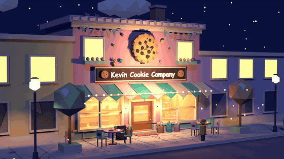

# Claude Blender Demo: Kevin Cookie Company

A low-poly, pastel cookie shop at night, built entirely by a Python script in Blender 5.3. The scene has a sign, a striped awning, a giant chocolate chip cookie, an outdoor café, and a lively street. The camera orbits the shop for 5 seconds.

[](https://az9713.github.io/Claude-blender-demo/)

The animation above plays right here. **Click it to open the full video player** (MP4 with play, pause, and fullscreen controls): https://az9713.github.io/Claude-blender-demo/

## The neighborhood tour

A 40-second tour of ten shops on one street, with the cookie shop in the middle. The camera visits every shop for the same time. Watch it, and jump to any shop: https://az9713.github.io/Claude-blender-demo/neighborhood.html

## The morning walk

A relaxing 60-second Saturday-morning stroll past the same ten shops. The camera never zooms and nobody goes inside. Watch it, and jump to any shop: https://az9713.github.io/Claude-blender-demo/walk.html

## How Claude and Blender made this

New to Blender? Read the step-by-step explainer. It shows every step with its inputs and outputs, and the real messages Claude and Blender exchanged, including the errors: https://az9713.github.io/Claude-blender-demo/how-it-works.html

## What is in the scene

- Pastel storefront with two display windows, a striped awning, and the sign "Kevin Cookie Company".
- A giant chocolate chip cookie above the entrance. It spins and bobs.
- Outdoor tables and chairs, flower pots, a chalkboard sign, bunting, a chimney, a hydrant, and a bin.
- Warm night lighting: glowing windows, awning string lights, door lamps, a spotlight on the cookie, and moonlight.
- Street life: a kid with a balloon, a dog, a walker, a customer who enters when the door opens, a car, a cat, and pigeons (one flies away).
- Small details that move: smoke, drifting clouds, swaying trees and bunting, twinkling stars, a flickering lamp, a shooting star, and fireflies.

## Files

| File | Purpose |
| --- | --- |
| `build_cookie_shop.py` | Builds the whole scene, the animation, and renders it. No external assets. |
| `cookie_shop_night.blend` | The finished scene with all animation. Open it in Blender and press Space. |
| `docs/` | The video page for GitHub Pages: `index.html`, `CookieShop.mp4`, `poster.jpg`, `preview.gif`. |

## Build it yourself

You need Blender 5.3. Run these commands in a terminal, in the folder with the script.

Render one still frame (frame 60) to `cookie_shop_night.png`:

```
blender -b -P build_cookie_shop.py -- still 60
```

Render the 5-second MP4 (1920x1080, 24 fps, H.264) to `CookieShop.mp4`. This took about 5 minutes on one Windows PC:

```
blender -b -P build_cookie_shop.py -- anim
```

The script also saves `cookie_shop_night.blend` next to itself.

## Notes

- Render engine: EEVEE, 48 samples per frame.
- Blender 5.x needs the output type set to Video before the FFmpeg format. The script does this.
- The shadow pool size is set to 1024 MB because the scene has more than 20 lights.
